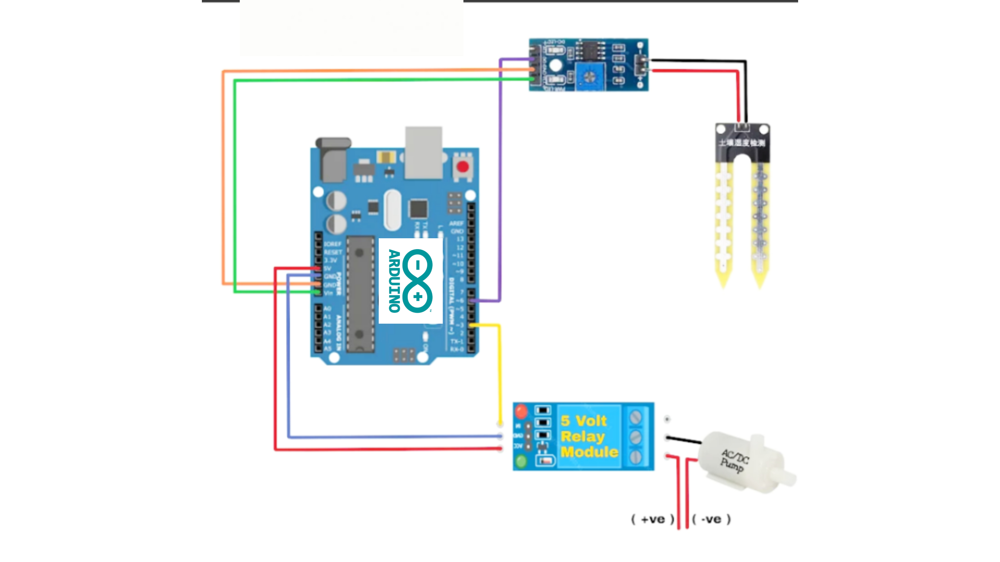
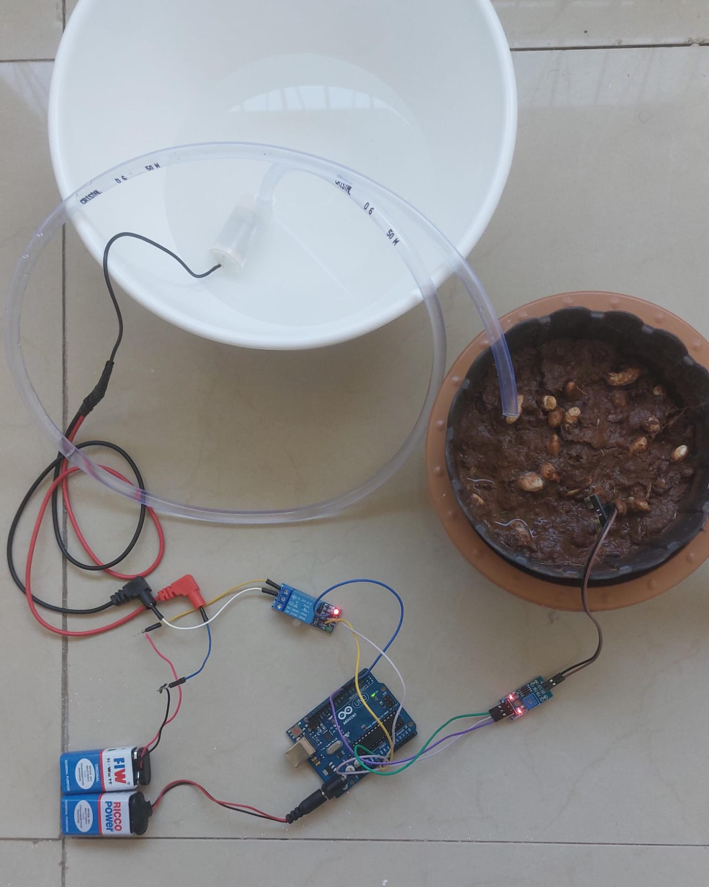

# Irrigation system

An Arduino reads a soil moisture sensor and switches a pump on through a relay when the soil is dry.

## Parts

- Arduino Uno
- Soil moisture sensor and its module
- 5V relay
- Small water pump
- Two 9V batteries (one for the Arduino, one for the pump)
- Wires

## Circuit

## Result

